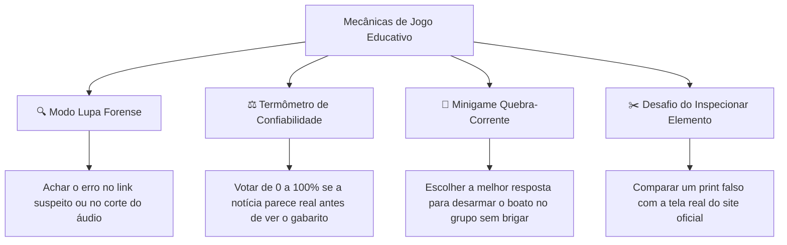

# Análise Temática: Fake News e Desinformação para Jogos Educativos
> **Foco:** Abordagem educativa, leve e envolvente para jovens e estudantes.  
> **Diretriz:** Sem temas político-partidários, sem conteúdos excessivamente pesados ou violentos.  
> **Objetivo:** Fornecer um catálogo completo de categorias, exemplos práticos, mecânicas e questões interativas que possam ser adaptadas para jogos narrativos e de tomada de decisão.

---

## 1. Visão Geral: A Desinformação no Cotidiano Jovem

Para que um jogo sobre *fake news* capture a atenção de adolescentes e jovens sem se tornar entediante ou excessivamente institucional, os temas precisam dialogar com o que eles **realmente vivenciam nas telas**:
* A busca por vantagens em jogos eletrônicos (skins, moedas virtuais, códigos).
* O medo de perder o acesso às redes sociais ou ter contas hackeadas.
* A curiosidade por fofocas, segredos da escola e vida de criadores de conteúdo/streamers.
* Vídeos curtos virais com truques caseiros ou desafios miraculosos.
* Prints de mensagens fora de contexto e montagens fáceis de criar com IA.

Ao afastar o tema da política institucional e de crimes pesados, o foco pedagógico migra para o **método de investigação**, o **letramento digital** e os **gatilhos emocionais** que nos fazem acreditar e repassar mentiras.

---

## 2. Categorias Temáticas, Exemplos e Banco de Questões

---

### CATEGORIA 1: Golpes de Recompensa Fácil e Falso Phishing
> **Foco:** Engenharia social, senso de urgência e roubo de credenciais disfarçado de oportunidade única.

#### O que é e como funciona
Mensagens que prometem vantagens gratuitas instantâneas (moedas de jogos como *Robux*, *V-Bucks*, diamantes no *Free Fire*, vouchers de fast-food, tênis de marcas famosas em comemoração de aniversário da empresa). O usuário é induzido a clicar em links encurtados ou domínios estranhos e "compartilhar com 10 amigos" para liberar o prêmio.

#### Exemplos de Cenários para o Jogo
* **Cenário A:** Uma mensagem chega no grupo de amigos: *"A Epic Games / Riot Games está dando 500 diamantes de graça pelo aniversário de 10 anos! Clique no link `promo-games-gratis.site/resgatar` e coloque seu login e senha antes que acabe hoje à meia-noite!"*
* **Cenário B:** Corrente de fast-food prometendo lanche de graça se responder a um questionário rápido e repassar para 5 contatos do WhatsApp.

#### Consequências no Mundo Real
Perda de contas de jogos com anos de progresso, roubo de dados pessoais dos pais cadastrados no aparelho, propagação automática de spans infectando contatos próximos.

#### Banco de Questões e Dilemas para o Jogador

* **Questão de Perícia (Investigação de Evidência):**
  > **Pergunta:** *"Você acessou a página da suposta promoção. Qual elemento abaixo é o maior sinal de que se trata de uma armadilha (phishing)?"*  
  > - **[A]** O endereço da barra de navegação termina em `.site-promocao.xyz` em vez do domínio oficial da empresa. *(Correta)*  
  > - **[B]** O site tem o logotipo da marca em alta definição.  
  > - **[C]** A página tem um contador regressivo marcando que restam apenas 3 minutos.  
  > - **[D]** Há comentários falsos de pessoas dizendo que já ganharam o prêmio.

* **Questão de Decisão Rápida (Ação do Jogador):**
  > **Situação:** Seu melhor amigo te enviou o link dizendo: *"Clica logo, cara, eu já mandei pra todo mundo pra desbloquear meu prêmio!"*. O que você faz?  
  > - **Opção [A]:** Acessar o site oficial da empresa em outra aba para ver se a promoção existe de verdade e avisar o amigo que ele caiu num golpe.  
  > - **Opção [B]:** Clicar rápido e colocar seus dados antes que os códigos promocionais acabem.

* **Provocação para a Sala (Debate / Mediador):**
  > *"Por que as promoções falsas sempre exigem que a gente compartilhe com outras pessoas antes de entregar o prêmio? Como os golpistas usam a nossa própria amizade para espalhar a armadilha?"*

---

### CATEGORIA 2: Mídias Manipuladas (Deepfakes, Clonagem de Voz e Áudios Fora de Contexto)
> **Foco:** A facilidade de forjar voz e imagem com inteligência artificial e os estragos provocados por gravações incompletas.

#### O que é e como funciona
Áudios de WhatsApp que parecem ser de uma pessoa conhecida falando mal de alguém, zombando de um colega ou confessando algo constrangedor. Pode ser uma voz clonada por IA com filtros simples ou um áudio real que teve os primeiros e últimos 10 segundos cortados para mudar 100% o sentido original da frase.

#### Exemplos de Cenários para o Jogo
* **Cenário A:** Circula um áudio de 6 segundos onde se escuta a voz de um aluno dizendo: *"Eu odeio essa sala e quero que todo mundo se dê mal"*. No áudio original completo de 40 segundos, ele estava lendo a fala de um vilão de uma peça de teatro da escola.
* **Cenário B:** Uma foto gerada por IA realista mostra um animal selvagem exótico solto no pátio do colégio, gerando tumulto e cancelamento de aulas.

#### Consequências no Mundo Real
Linchamento moral de pessoas inocentes, desespero e isolamento social da vítima, desconfiança generalizada em relação a qualquer prova em áudio ou vídeo.

#### Banco de Questões e Dilemas para o Jogador

* **Questão de Análise Forense:**
  > **Pergunta:** *"Ao analisar um áudio curto suspeito que está viralizando, quais pistas revelam que ele pode ter sido editado ou gerado por inteligência artificial?"*  
  > - **[A]** Cortes secos e abruptos no início/fim, ausência de barulho de respiração natural e tom de voz monótono sem oscilação de ambiente. *(Correta)*  
  > - **[B]** O áudio ter sido gravado em formato de mensagem de voz do WhatsApp.  
  > - **[C]** A pessoa falar rápido demais demonstrando nervosismo.

* **Questão de Decisão (Postura Ética):**
  > **Situação:** Todos no recreio estão repassando um áudio chocante zombando de uma aluna. Você acabou de receber. Qual atitude tomar?  
  > - **Opção [A]:** Interromper a corrente: não repassar, pedir para ouvir a versão completa ou procurar a pessoa diretamente antes de formar julgamento.  
  > - **Opção [B]:** Encaminhar para o outro grupo dizendo *"Vocês já viram isso?! Não sei se é verdade, só tô repassando!"*.

* **Provocação para a Sala (Debate):**
  > *"Se alguém criar uma foto ou áudio falso com a sua voz hoje, o quanto você sofreria até conseguir provar para todo mundo que não foi você? Por que repassar 'só pra ver se é verdade' já é uma forma de ataque?"*

---

### CATEGORIA 3: Correntes de Pânico e "Lendas Urbanas Digitais"
> **Foco:** Mensagens alarmistas que exploram o medo, a superstição ou a ameaça de perder ferramentas essenciais.

#### O que é e como funciona
Mensagens com teor urgente e catastrófico ordenando repasse imediato. Utilizam linguagem dramática, letras maiúsculas, emojis de sirene e ameaças implícitas ("Se não repassar, sua conta será bloqueada", "Um novo desafio misterioso está infectando câmeras de celulares").

#### Exemplos de Cenários para o Jogo
* **Cenário A:** *"URGENTE! O WhatsApp vai passar a cobrar R$ 0,50 por mensagem a partir de segunda-feira. Para manter o aplicativo gratuito, envie esta mensagem para 20 contatos. A marca ficará azul confirmando que você é um usuário ativo!"*
* **Cenário B:** *"Alerta para todos os pais e alunos: hackers descobriram uma falha que faz a bateria do celular explodir se receber uma ligação com código +99. Repassem imediatamente!"*

#### Consequências no Mundo Real
Pânico em pessoas mais vulneráveis (crianças, pais, idosos), sobrecarga de canais de atendimento, ansiedade desnecessária e perda de tempo.

#### Banco de Questões e Dilemas para o Jogador

* **Questão de Perícia Textual:**
  > **Pergunta:** *"Qual é a característica clássica presente em quase 100% das correntes falsas de alerta na internet?"*  
  > - **[A]** Pedido desesperado de compartilhamento em massa sem citar links de fontes oficiais, dados técnicos ou datas precisas. *(Correta)*  
  > - **[B]** Uso de termos técnicos muito complexos de informática.  
  > - **[C]** Presença de assinatura com nome completo de um engenheiro renomado.

* **Questão de Convivência Digital:**
  > **Situação:** Um parente ou colega de classe envia no grupo da família uma corrente avisando que "o aplicativo de notas da escola vai apagar todas as notas dos alunos amanhã". Como você reage?  
  > - **Opção [A]:** Pesquisar no site oficial da escola ou falar com a coordenação, e responder no grupo de forma gentil com o link desmentindo o boato.  
  > - **Opção [B]:** Ficar desesperado, tirar prints de tudo e espalhar para todas as turmas que a escola perdeu os dados.

* **Provocação para a Sala (Debate):**
  > *"Por que as pessoas têm mais facilidade de repassar notícias de medo e tragédia do que notícias positivas ou soluções reais?"*

---

### CATEGORIA 4: Mitos de Saúde, Desafios Virais Perigosos e "Hacks Milagrosos"
> **Foco:** Desinformação que promete soluções instantâneas fáceis, mas que gera riscos de segurança ou estragos materiais.

#### O que é e como funciona
Canais que publicam vídeos com "truques caseiros" falsos montados apenas para caçar visualizações e engajamento. Também inclui mitos sobre o corpo, saúde e equipamentos eletrônicos que não possuem qualquer embasamento científico.

#### Exemplos de Cenários para o Jogo
* **Cenário A:** Um vídeo no TikTok com 5 milhões de curtidas ensina que *"colocar o celular no micro-ondas por 10 segundos recarrega a bateria até 100% instantaneamente através de indução magnética"*.
* **Cenário B:** *"Mistura mágica de produtos de limpeza caseiros com refrigerante remove manchas e clareia tênis em 2 minutos"* (mistura tóxica que queima a pele ou gera gases asfixiantes).
* **Cenário C:** *"Comer apenas maçã por 5 dias faz qualquer pessoa perder 10 kg sem esforço e melhora a imunidade"*.

#### Consequências no Mundo Real
Aparelhos eletrônicos incendiados ou destruídos, intoxicação por inalação de produtos químicos, problemas nutricionais e acidentes domésticos em jovens que tentam reproduzir os "testes".

#### Banco de Questões e Dilemas para o Jogador

* **Questão de Pensamento Crítico:**
  > **Pergunta:** *"Muitos canais produzem vídeos com 'gambiarras milagrosas' que não funcionam. Por que esses criadores continuam postando se sabem que é mentira?"*  
  > - **[A]** Porque vídeos absurdos geram curiosidade, revolta nos comentários e milhões de cliques, o que gera muito dinheiro com anúncios para o canal. *(Correta)*  
  > - **[B]** Porque eles acreditam sinceramente que a ciência oficial está escondendo esses segredos.  
  > - **[C]** Porque as plataformas de redes sociais banem quem posta soluções verdadeiras.

* **Questão de Intervenção Preventiva:**
  > **Situação:** Seu irmão mais novo ou um colega está prestes a ligar o secador de cabelo em potência máxima dentro de uma garrafa plástica para tentar um "desafio de foguete" que viu em um vídeo viral. O que você faz?  
  > - **Opção [A]:** Desligar o aparelho da tomada imediatamente, mostrar que o vídeo na internet usou cortes de edição e explicar o risco de incêndio.  
  > - **Opção [B]:** Pegar o celular para filmar a experiência e postar no stories para ver o que acontece.

* **Provocação para a Sala (Debate):**
  > *"Se um vídeo tem 10 milhões de visualizações e milhares de elogios nos comentários (que podem ser bots ou pessoas ironizando), isso é prova de que aquilo funciona na vida real?"*

---

### CATEGORIA 5: Caça-Cliques de Entretenimento, Fofocas de Gamers e "Prints Falsificados"
> **Foco:** A indústria do boato sobre celebridades, jogos aguardados, animes e esportes, impulsionada por adulteração de imagens.

#### O que é e como funciona
Criação de notícias falsas sobre o universo pop juvenil (streamers banidos, jogos cancelados, adiamentos falsos, brigas inventadas entre criadores de conteúdo). O método mais comum é tirar um print de um site oficial (como G1, IGN ou Twitter/X) e usar o comando "Inspecionar Elemento" do navegador para alterar o texto da manchete e fingir que é uma notícia real.

#### Exemplos de Cenários para o Jogo
* **Cenário A:** Um print perfeito da conta oficial da Rockstar Games afirmando que *GTA 6* foi cancelado e não será lançado. O print circula freneticamente em grupos de Discord e WhatsApp.
* **Cenário B:** Print de um portal de notícias com a manchete: *"Streamer mais famoso do Brasil é banido permanentemente após confessar uso de trapaça em campeonato oficial"*.
* **Cenário C:** Notícia de que um time de futebol famoso demitiu todos os jogadores titulares após uma derrota.

#### Consequências no Mundo Real
Decepção e histeria em comunidades de fãs, ataques injustos ao perfil de criadores e atletas, perda de credibilidade das fontes reais.

#### Banco de Questões e Dilemas para o Jogador

* **Questão de Perícia Digital (Técnica do Print):**
  > **Pergunta:** *"Por que um 'print de tela' NUNCA deve ser considerado uma prova definitiva na internet?"*  
  > - **[A]** Porque qualquer pessoa consegue apertar F12 no teclado (Inspecionar Elemento) e trocar qualquer texto de um site oficial em menos de 10 segundos antes de tirar a foto. *(Correta)*  
  > - **[B]** Porque imagens de tela perdem a qualidade e não podem ser lidas por computadores.  
  > - **[C]** Porque os sites bloqueiam a tecla Print Screen automaticamente quando a notícia é verdadeira.

* **Questão de Checagem Rápida:**
  > **Situação:** Você vê no Twitter uma imagem chocante afirmando que seu jogo favorito vai se tornar pago por mensalidade a partir do mês que vem. Qual a forma mais rápida de desmentir?  
  > - **Opção [A]:** Ir diretamente ao site oficial ou blog dos desenvolvedores e procurar se existe um comunicado oficial publicado.  
  > - **Opção [B]:** Responder com raiva no post xingando a empresa pelo anúncio.

* **Provocação para a Sala (Debate):**
  > *"Por que é tão fácil as pessoas acreditarem em um print montado quando ele fala exatamente aquilo que elas tinham medo que acontecesse?"*

---

### CATEGORIA 6: Pseudociência Curiosa, Mistérios Fabricados e Fotos Fora de Contexto
> **Foco:** Imagens reais tiradas do seu contexto original (filmes, esculturas, simulações 3D) para simular eventos surreais no mundo físico.

#### O que é e como funciona
Publicação de fotos impressionantes acompanhadas de legendas fantasiosas: criaturas místicas encontradas em florestas, tempestades artificiais, profecias climáticas absurdas ("A Terra ficará 3 dias no escuro total por causa de um cometa"). Na realidade, a foto é uma maquete de filme, arte conceitual em 3D ou um fenômeno natural comum com saturação de cor exagerada no Photoshop.

#### Exemplos de Cenários para o Jogo
* **Cenário A:** Foto de uma escultura de silicone hiper-realista exposta num museu da Europa é compartilhada como: *"Criatura extraterrestre achada por pescadores no litoral do Brasil hoje de manhã!"*.
* **Cenário B:** Uma foto de satélite de uma nuvem comum de poeira é publicada como: *"Nuvem tóxica misteriosa está avançando sobre as cidades e todos devem fechar as janelas"*.

#### Consequências no Mundo Real
Alimentação de teorias da conspiração, desconfiança nos órgãos meteorológicos e científicos, desinformação cultural.

#### Banco de Questões e Dilemas para o Jogador

* **Questão de Uso de Ferramentas Digitais:**
  > **Pergunta:** *"Qual ferramenta gratuita qualquer pessoa pode usar no navegador para descobrir em segundos de onde uma foto suspeita realmente veio?"*  
  > - **[A]** A Busca Reversa por Imagem (como Google Imagens ou TinEye). *(Correta)*  
  > - **[B]** Um antivírus instalado no computador.  
  > - **[C]** O tradutor automático de páginas.

* **Questão de Lógica e Proporcionalidade:**
  > **Situação:** Uma postagem no Instagram afirma que a NASA confirmou que a gravidade da Terra vai sumir por 5 segundos no próximo domingo ao meio-dia. Como usar o bom senso para avaliar essa notícia?  
  > - **Opção [A]:** Raciocinar: se algo tão grandioso fosse acontecer, a notícia estaria abrindo todos os jornais, televisões e canais de ciência do planeta, e não apenas em uma página de fofoca.  
  > - **Opção [B]:** Amarrar os móveis do quarto para não flutuarem no domingo.

* **Provocação para a Sala (Debate):**
  > *"Por que tantas pessoas preferem acreditar em explicações mágicas ou misteriosas na internet antes de buscar o que a ciência diz sobre o fenômeno?"*

---

### CATEGORIA 7: Páginas de Fofoca Anônimas ("Exposeds" Escolares e Perfis Clones)
> **Foco:** A covardia do anonimato, calúnia entre colegas de turma e a destruição da reputação social.

#### O que é e como funciona
Criação de contas secundárias em redes sociais (ex: `@escola_exposed`, `@fofocas_turma_b`) gerenciadas por pessoas anônimas que recebem boatos por caixas de perguntas do Instagram e publicam sem checagem nenhuma. Também abrange perfis fakes que usam foto e nome de colegas para passar vergonha.

#### Exemplos de Cenários para o Jogo
* **Cenário A:** Uma página anônima posta uma foto de duas pessoas conversando no intervalo com a legenda maldosa: *"Pegamos no flagra! Olhem quem tá traindo o grupo de amigos com o rival da outra sala!"*.
* **Cenário B:** Uma caixa de perguntas no Instagram publica: *"Disseram que alguém colou na prova e culpou o representante de classe"*, iniciando uma caça às bruxas na escola.

#### Consequências no Mundo Real
Ansiedade profunda, isolamento social da vítima, brigas físicas nos corredores, abandono escolar e danos emocionais irreparáveis.

#### Banco de Questões e Dilemas para o Jogador

* **Questão de Responsabilidade Compartilhada:**
  > **Pergunta:** *"Se você não criou a página de fofocas da escola, mas curte as postagens, segue o perfil e envia para outros colegas no privado, qual é o seu papel nessa situação?"*  
  > - **[A]** Você está ajudando a manter a página ativa, pois o algoritmo só entrega a desinformação se houver pessoas dando curtidas e audiência. *(Correta)*  
  > - **[B]** Você é totalmente neutro, já que só está assistindo sem escrever nada.  
  > - **[C]** Você está apenas exercendo sua curiosidade, o que não prejudica a vítima.

* **Questão de Ação Reparadora:**
  > **Situação:** Um boato maldoso sobre um colega tímido está crescendo na página anônima da escola e você sabe com certeza que a história é falsa. Qual é a melhor atitude?  
  > - **Opção [A]:** Denunciar a página anônima para a rede social por assédio/cyberbullying, alertar a coordenação ou os professores e prestar apoio ao colega afetado.  
  > - **Opção [B]:** Ficar quieto para que a página anônima não resolva inventar uma fofoca sobre você também.

* **Provocação para a Sala (Debate):**
  > *"Por que quem cria perfis de 'exposed' nunca usa a própria foto nem o próprio nome? O que o anonimato revela sobre a coragem de quem espalha boatos?"*

---

## 3. Matriz Sintética das Categorias

| Categoria | Tipo de Engano | Gatilho Psicológico Usado | Dica de Ouro de Checagem |
| :--- | :--- | :--- | :--- |
| **1. Golpes de Jogos / Phishing** | Link fraudulento e roubo de senhas | Ganância e Urgência ("restam 5 vagas") | Olhar o domínio na barra de endereços |
| **2. Mídias Manipuladas (IA/Cortes)** | Áudios montados, deepfakes e cortes | Choque e Indignação | Procurar o contexto completo e respiração |
| **3. Correntes de Pânico** | Ameaças de cancelamento de contas/perigo | Medo e Superstição | Observar o pedido de "repasse obrigatório" |
| **4. Hacks & Mitos de Saúde** | Truques falsos para aparelhos ou corpo | Promessa de facilidade / Preguiça | Buscar comprovação científica independente |
| **5. Clickbaits de Games & Fãs** | Prints editados com F12 / Manchetes | Curiosidade e Paixão por um tema | Ir ao site/perfil oficial verificar se existe |
| **6. Fotos Fora de Contexto** | Obras de arte/filmes passados por reais | Fascínio pelo bizarro / Sobrenatural | Fazer Busca Reversa de Imagem no Google |
| **7. Perfis de Fofoca / Exposed** | Invenções anônimas sobre pessoas | Prazer na fofoca alheia / Schadenfreude | Lembrar: sem autoria e sem prova = difamação |

---

## 4. Ideias de Mecânicas Interativas para o Jogo

Para transformar essas categorias em mecânicas divertidas dentro de um motor web (React/Vite), podem ser implementados minigames rápidos:

1. **Modo "Lupa Forense" (Spot the Fake):**
   * O jogo mostra uma captura de tela (ex: e-mail de recompensa ou página da web).
   * O jogador clica nas 3 pistas suspeitas (link estranho `.xyz`, erro de português grosseiro, ausência de cadeado de segurança).
2. **Termômetro de Confiabilidade (Votação da Sala):**
   * Antes de revelar se o boato é real ou falso, a turma/jogador ajusta uma barra deslizante: *"Quantos % você confia nessa notícia?"*.
   * O jogo revela os bastidores da criação da mentira, surpreendendo os que deram alta pontuação.
3. **Quebra-Corrente (Simulador de Chat):**
   * O jogador recebe mensagens simuladas de amigos com boatos e precisa escolher a melhor mensagem de resposta para estancar o boato sem ofender o colega.

---

## 5. Alinhamento Pedagógico com a BNCC

A utilização desses temas não-políticos cumpre diretamente as diretrizes da **Base Nacional Comum Curricular (BNCC)** para o Ensino Fundamental:

* **Competência Geral 5 (Cultura Digital):** Compreender, utilizar e criar tecnologias digitais de informação de forma crítica, significativa, reflexiva e ética.
* **Habilidade EF69LP03 (Língua Portuguesa / Letramento Midiático):** Identificar o uso de recursos de persuasão em textos da esfera publicitária e jornalística e analisar criticamente o fenômeno das *fake news*.
* **Habilidade EF67EF01 / Convivência Digital:** Promover a empatia, o combate ao cyberbullying e a valorização do respeito à privacidade dos pares no ambiente escolar.
