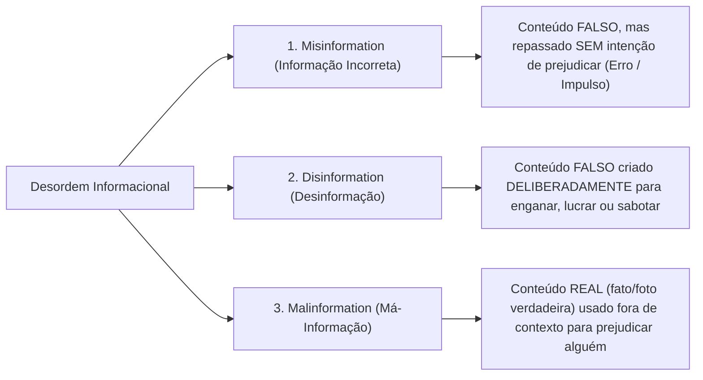

# Avaliação Detalhada de Viabilidade, Pesquisa sobre Desinformação e Propostas de Evolução do Enredo

> **Documento de Referência Analisado:** `./ideia-enredo.md`  
> **Base Arquitetural e Mecânica Comparada:** Projeto atual (`./` — *Operação Camisa 10: O Mistério da Rifa do Interclasses*)  
> **Escopo Temático:** Desinformação, *Fake News*, Engenharia Social e Cidadania Digital em contextos **não-políticos** e **não-extremos**.

---

## Sumário Executivo

Este documento apresenta uma análise técnica, narrativa e pedagógica completa sobre a viabilidade de implementar os contextos propostos em `./ideia-enredo.md` dentro da arquitetura de jogo interativo representada por este repositório. Além disso, consolida uma pesquisa aprofundada sobre a ciência da desinformação no cotidiano (fora do eixo político-partidário) e propõe modificações e adições estruturais para transformar as ideias iniciais em uma experiência gamificada coesa, engajadora e alinhada aos critérios de avaliação da Cidadania Digital.

---

## PARTE 1: Compreensão da Arquitetura Atual (`./`) e Análise de Viabilidade

### 1.1. O que o diretório `./` representa na prática?

O projeto atual (*Operação Camisa 10*) é uma **Visual Novel Investigativa / RPG de Tomada de Decisão** desenvolvida em **React + Vite + Tailwind CSS**, projetada para rodar 100% offline em navegadores (seja em projeção coletiva em sala de aula com um mediador, seja individualmente em laboratórios). Sua estrutura apoia-se em **5 pilares mecânicos**:

1. **Fluxo Sequencial em 3 Atos (`src/data/gameData.js`):** Uma narrativa contínua dividida em **25 decisões binárias** (`Opção [A]` vs. `Opção [B]`), onde cada escolha altera imediatamente o estado emocional e investigativo da partida.
2. **Medidores Dinâmicos em Tempo Real (`src/components/game/HUD.jsx`):** Duas barras de progresso de `0%` a `100%` (atualmente *Revolta da Sala* e *Investigação*), que determinam matematicamente qual dos **3 Finais** (`good`, `neutral`, `bad`) o jogador/turma alcançará em `EndGameScreen.jsx`.
3. **Inspeção Forense de Evidências Digitais (`src/components/sprites/EvidenceOverlay.jsx`):** Um modal interativo que simula telas de celular, postagens de redes sociais, zoom em fotos, ondas sonoras de áudios cortados e comparação de prints falsos vs. reais.
4. **Mediação Pedagógica (`src/components/game/MediatorModal.jsx`):** Um painel acionável (tecla `M` ou botão na HUD) que exibe perguntas provocadoras para debate e reflexão ética antes do voto.
5. **Avaliação Formal de Aprendizagem (`src/components/game/EvaluationScreen.jsx`):** Tela final de coleta de indicadores de fixação conceitual e exportação de relatório em JSON.

---

### 1.2. Avaliação Detalhada de Viabilidade dos Contextos de `./ideia-enredo.md`

De modo geral, a viabilidade técnica e pedagógica de utilizar os contextos propostos em `./ideia-enredo.md` dentro de um jogo com a mesma estrutura deste diretório é **ALTÍSSIMA (9,2 / 10)**. No entanto, há uma diferença importante entre a **viabilidade mecânica** (que é imediata) e a **viabilidade de coesão narrativa** (que exige conectar os exemplos soltos em uma trama única ou episódica).

Abaixo, avaliamos cada contexto individualmente:

#### Contexto (1): Boatos sobre um Concurso Público ("Banca mudou", "Local mudou", "Data mudou")

* **Viabilidade Técnica no Motor Atual:** **10/10 (Perfeita)**
  * O componente `EvidenceOverlay.jsx` pode facilmente exibir o contraste entre um **post alarmista de página de fofoca/concursos** e um **recorte oficial do Edital em PDF / Diário Oficial da União**, permitindo que o jogador dê zoom na URL, na assinatura do documento ou na data de publicação.
  * Os medidores da HUD podem ser adaptados sem mudar uma linha de lógica no `App.jsx`:
    * `revolta` $\rightarrow$ **Nível de Pânico / Desinformação (`0%` a `100%`)**
    * `investigacao` $\rightarrow$ **Checagem de Fontes / Preparo (`0%` a `100%`)**
* **Viabilidade de Público-Alvo:** **8/10 (Depende da Faixa Etária)**
  * **Para Ensino Médio, Ensino Técnico (IFs), Pré-Vestibular, Universitários e Jovens Adultos:** É um tema excelente, realista e gera identificação imediata (especialmente se associado ao **ENEM**, **Vestibular** ou **Processo Seletivo do IFCE**).
  * **Para Ensino Fundamental II (6º ao 8º ano — 11 a 13 anos):** O conceito de "concurso público e leitura de edital de banca organizadora" é distante da vivência infantil/pré-adolescente. Se o público for mais jovem, recomenda-se adaptar o "Concurso Público" para o **Processo Seletivo de Entrada no Instituto Federal**, **Olimpíada Nacional de Ciências/Matemática (OBMEP)** ou **Exame de Bolsa de Estudos**.
* **Viabilidade Dramática:** **8,5/10**
  * Isoladamente, receber três notícias falsas seguidas ("mudou a banca", "mudou o local", "mudou a data") pode ficar repetitivo se a mecânica for apenas "ler o edital". Para sustentar um jogo completo no estilo *Camisa 10*, é fundamental adicionar **uma motivação oculta por trás do boato** (ex: quem está espalhando isso quer vender apostilas falsas de "última hora", aplicar um golpe de "taxa de reimpressão de local de prova" ou desestabilizar concorrentes em grupos de estudo).

---

#### Contexto (2) — EX1: "Telefone sem Fio" (Recomendação no YouTube sobre morte de famoso compartilhada sem abrir o vídeo)

* **Viabilidade Técnica no Motor Atual:** **9,5/10**
  * Representa o clássico fenômeno de **Clickbait / Falsa Conexão** combinado ao compartilhamento por impulso.
  * No `EvidenceOverlay.jsx`, é muito simples desenhar um card simulando o final de um player do YouTube com uma *thumbnail* apelativa em preto e branco (*"URGENTE: O BRASIL CHORA A PERDA DE..."*). Se o jogador clicar na evidência para "Abrir o Vídeo / Checar Canal", descobre que o vídeo fala da morte de um personagem de ficção, que foi postado por um canal de *spam* sem selo de verificação, ou que nenhum portal de jornalismo profissional noticiou o fato.
* **Viabilidade Narrativa:** **8/10**
  * Como evento isolado, dura poucas telas (2 a 3 decisões). Porém, funciona de maneira brilhante como **Abertura do Jogo (Quebra-Gelo do Ato I)** para demonstrar como uma mentira boba ganha proporções gigantescas à medida que cada amigo repassa aumentando um ponto ("telefone sem fio digital").

---

#### Contexto (2) — EX2: Segurança ("Função secreta no Instagram para descobrir quem visitou seu perfil" $\rightarrow$ App malicioso)

* **Viabilidade Técnica no Motor Atual:** **10/10 (Altíssimo Potencial)**
  * É um dos golpes de **Engenharia Social e Phishing/Malware** que mais fazem vítimas reais entre adolescentes e jovens adultos no Brasil.
  * Visualmente, o `EvidenceOverlay.jsx` pode mostrar o anúncio patrocinado nos *Stories* com layout chamativo, seguido de uma tela falsa de login ("Entre com sua conta do Instagram para liberar o relatório de visitantes") ou permissões abusivas do app.
* **Viabilidade Narrativa:** **10/10 (Conector Perfeito de Enredo)**
  * Além de ensinar cibersegurança prática (o Instagram/Meta **não** fornece lista de visitantes a aplicativos de terceiros), esse contexto gera uma **consequência narrativa excelente**: ao instalar o app malicioso, a personagem tem o perfil sequestrado (*account takeover*), e os criminosos passam a usar a conta dela para espalhar novas notícias falsas ou golpes do Pix para os amigos!

---

#### Contexto (2) — EX3: Páginas que vendem Ebooks com propostas milagrosas

* **Viabilidade Técnica no Motor Atual:** **8,5/10**
  * Pode ser representado no `EvidenceOverlay.jsx` como uma *Landing Page* apelativa cheia de gatilhos mentais: contador regressivo falso (*"A oferta expira em 02:14"*), promessas anticientíficas (*"Passe em qualquer prova sem ler livros em 7 dias"* ou *"Ganhe R$ 500 por dia pelo celular"*), e comentários de perfis robóticos (*bots*).
* **Viabilidade Narrativa:** **8,5/10**
  * Funciona muito melhor se **integrado ao Contexto (1) ou ao EX4**. Por exemplo: a página que espalha o boato de que "a banca do concurso mudou" coloca no final do post o link para comprar o *"Ebook Secreto: O Novo Padrão da Banca Desvendado por R$ 47,90"*. Assim, o jogador compreende a **motivação financeira** por trás da fabricação de *fake news*.

---

#### Contexto (2) — EX4: Vídeos feitos por IA (Deepfake de famosos falando algo ou vendendo produtos)

* **Viabilidade Técnica no Motor Atual:** **10/10**
  * Extremamente atual e indispensável em projetos de Cidadania Digital em 2026.
  * O motor atual já suporta simulação de ondas de áudio (`audio_wave`) e ilustrações vetoriais em `EvidenceOverlay.jsx`, além de áudio pré-renderizado. O jogador pode inspecionar pistas visuais e sonoras de IA generativa: voz com cadência metálica sem respiração, cortes labiais estranhos, legenda automática encobrindo a boca, ou o fato de uma celebridade bilionária estar anunciando um "ebook/produto milagroso" em uma página criada há 2 dias.
* **Viabilidade Narrativa:** **9,5/10**
  * Conecta-se diretamente ao EX3 (o famoso gerando credibilidade falsa para vender o ebook milagroso ou um site falso de inscrição de concurso).

---

### Síntese da Viabilidade em Tabela Comparativa

| Contexto Proposto em `ideia-enredo.md` | Aderência à Mecânica Atual (`./`) | Potencial de Engajamento | Complexidade de Adaptação Visual (`EvidenceOverlay`) | Nota Geral de Viabilidade |
| :--- | :---: | :---: | :---: | :---: |
| **(1) Boatos sobre Concurso Público** | ⭐⭐⭐⭐⭐ | ⭐⭐⭐⭐ (Alto p/ Jovens/EM) | Baixa (Print de Post vs. PDF do Edital) | **9,0 / 10** |
| **(2.EX1) "Telefone sem Fio" no YouTube** | ⭐⭐⭐⭐⭐ | ⭐⭐⭐⭐⭐ | Baixa (Miniatura Clickbait do YouTube) | **9,2 / 10** |
| **(2.EX2) App "Quem Visitou seu Perfil"** | ⭐⭐⭐⭐⭐ | ⭐⭐⭐⭐⭐ | Baixa (Anúncio de Story + Tela Phishing) | **10,0 / 10** |
| **(2.EX3) Ebooks com Propostas Milagrosas** | ⭐⭐⭐⭐ | ⭐⭐⭐⭐ | Baixa (Página de Vendas com Gatilhos) | **8,5 / 10** |
| **(2.EX4) Deepfake / IA com Famosos** | ⭐⭐⭐⭐⭐ | ⭐⭐⭐⭐⭐ | Média (Simulação de Vídeo/Áudio Sintético) | **9,8 / 10** |

---

## PARTE 2: Pesquisa Aprofundada sobre Fake News e Desinformação (Contextos Não-Políticos e Cotidianos)

Para fundamentar o roteiro do jogo e o guia do mediador (`MediatorModal.jsx`), apresentamos uma sistematização teórica e prática baseada nas diretrizes da **UNESCO** (*Alfabetização Midiática e Informacional - AMI*) e nos estudos de **Claire Wardle e Hossein Derakhshan** (*First Draft / Conselho da Europa*), adaptada especificamente para **temas não-políticos e não-extremos**.

---

### 2.1. A Tripla Conceituação da "Desordem Informacional"

Na literatura científica e educacional moderna, evita-se tratar tudo apenas como *"fake news"*, pois nem toda informação problemática segue a mesma lógica. Divide-se o fenômeno em **três categorias baseadas em dois eixos: Falsidade e Intenção de Causar Dano**:

1. **Informação Incorreta (*Misinformation*):**
   * **O que é:** A informação é falsa ou imprecisa, mas a pessoa que está compartilhando **acredita sinceramente que está ajudando** ou informando os amigos.
   * **Exemplo no seu enredo:** O jovem do **EX1** que vê a *thumbnail* dizendo que um ator famoso morreu e avisa no grupo da turma, ou o colega que repassa no grupo de estudos que "o local da prova mudou" achando que está salvando os amigos de perderem o exame.
2. **Desinformação (*Disinformation*):**
   * **O que é:** Conteúdo falso fabricado **intencionalmente** com objetivo malicioso: ganhar dinheiro com cliques (monetização), aplicar golpes financeiros, roubar dados (phishing) ou sabotar concorrentes.
   * **Exemplo no seu enredo:** O criador do anúncio falso do app que mostra "quem visitou o perfil" (**EX2**), o golpista que cria *deepfake* de famoso (**EX4**) para vender *ebook* milagroso (**EX3**), ou a página que mente sobre o cancelamento da banca (**Contexto 1**) para vender material "atualizado".
3. **Má-Informação (*Mal-information*):**
   * **O que é:** Baseia-se em um fato ou registro verdadeiro (uma foto real, um trecho de edital antigo, um vídeo real), mas é divulgado de forma distorcida, fora de época ou violando a privacidade para gerar dano ou pânico.
   * **Exemplo prático:** Pegar uma notícia verdadeira de **2021** onde uma prova de concurso foi adiada por causa de uma chuva forte e repostar **hoje** na véspera do concurso atual sem mostrar o ano da notícia original.

---

### 2.2. Os 7 Tipos de Desinformação e Fake News (Taxonomia de Wardle Aplicada ao Cotidiano)

Para que os jogadores desenvolvam o olhar crítico previsto nos objetivos do `./ideia-enredo.md`, o jogo pode apresentar gradualmente os **7 formatos clássicos** em que o engano se manifesta fora da política:

#### 1. Sátira ou Paródia Interpretada como Fato
* **Definição:** Páginas de humor, memes ou perfis paródia publicam notícias absurdas por diversão, mas usuários distraídos leem apenas a imagem e compartilham como se fosse verdade.
* **Exemplo Não-Político (Concursos/Estudos):** Um perfil de humor estudantil posta um card com visual jornalístico: *"MEC anuncia que candidatos que chegarem atrasados no ENEM poderão fazer a prova pelo WhatsApp pagando taxa de R$ 15"*. Alguém corta o logotipo de humor e joga no grupo da família.

#### 2. Falsa Conexão (*Clickbait* / Caça-Cliques)
* **Definição:** A manchete, a legenda ou a miniatura (*thumbnail*) promete algo bombástico e chocante que **não tem relação com o conteúdo real** do texto ou do vídeo.
* **Exemplo Não-Político (Redes Sociais - EX1):** A capa do vídeo no YouTube mostra a foto de um cantor famoso em preto e branco com uma fita de luto e o título *"ADEUS! BRASIL EM LUTO NESTA MANHÃ..."*. Quem compartilha sem assistir espalha que o cantor morreu; quem assiste aos 10 minutos descobre que o vídeo fala apenas que o cantor "deu adeus ao cabelo comprido" ou perdeu um animal de estimação.

#### 3. Conteúdo Enganoso (*Misleading Content*)
* **Definição:** Uso seletivo de informações reais, meias-verdades ou pseudociência para induzir o leitor a uma conclusão falsa.
* **Exemplo Não-Político (Ebooks e Hacks - EX3):** Uma página vende um *"Ebook de Neurociência: Como Memorizar 100% do Edital Dormindo"*, citando que *"cientistas de Harvard comprovam que o cérebro consolida memórias durante o sono"* (fato real), mas usando isso para vender um áudio falso que promete aprovação sem estudar (conclusão enganosa).

#### 4. Falso Contexto (*False Context*)
* **Definição:** O material (foto, vídeo ou documento) é **100% genuíno**, sem nenhuma edição técnica, mas é acompanhado de uma legenda que mente sobre **quando**, **onde** ou **por que** aquilo aconteceu.
* **Exemplo Não-Político (Concursos - Contexto 1):** Circula um vídeo real de portões fechados e candidatos chorando em frente a uma escola com a legenda: *"URGENTE! Mudaram o local da prova de hoje de manhã sem avisar ninguém!"*. Na verdade, o vídeo é real, mas foi gravado há 3 anos em outra cidade.

#### 5. Conteúdo Impostor (*Imposter Content*)
* **Definição:** Perfis falsos, páginas ou sites fraudulentos que copiam o logotipo, as cores, a tipografia e o nome de instituições oficiais, bancas de concurso, marcas famosas ou celebridades para roubar credibilidade.
* **Exemplo Não-Político (Concursos & Segurança - Contexto 1 e EX2):**
  * Um perfil no Instagram chamado `@cebraspe.oficial.aviso` (com a logo oficial copiada) publica uma "Nota de Alteração de Data da Prova".
  * Uma página copia o visual idêntico da tela de login do Instagram para capturar a senha da jovem que clicou no anúncio de "ver quem visitou o perfil" (**EX2**).

#### 6. Conteúdo Manipulado (*Manipulated Content*)
* **Definição:** Uma imagem, captura de tela (*print*), documento ou áudio real que sofreu adulteração técnica proposital (como edição no Photoshop, corte malicioso de áudio ou uso da ferramenta **"Inspecionar Elemento / F12"** do navegador).
* **Exemplo Não-Político:** Alguém abre o site oficial da banca organizadora do concurso, aperta `F12` no navegador, altera o texto *"Prova: 15 de Novembro"* para *"Prova CANCELADA — Nova data em Dezembro"*, tira um print da tela e espalha nos grupos de WhatsApp dos candidatos.

#### 7. Conteúdo Fabricado e Mídia Sintética por IA (*Fabricated Content & Deepfakes*)
* **Definição:** Conteúdo 100% inventado do zero, hoje amplamente potencializado por ferramentas de Inteligência Artificial Generativa (clonagem de voz com poucos segundos de amostra e sincronia labial por vídeo — *lip-sync deepfake*).
* **Exemplo Não-Político (IA e Famosos - EX4):** Um vídeo patrocinado no Instagram/TikTok mostra um jornalista famoso da TV ou um grande *youtuber* de educação falando com a própria voz: *"O governo liberou um lote secreto de apostilas gratuitas / Ebook de aprovação automática, clique no botão abaixo e pague apenas a taxa de envio"*.

---

### 2.3. Contextos Comuns em que Ocorrem e Gatilhos Psicológicos Explorados

Por que pessoas inteligentes, estudantes dedicados (como o "candidato X" do `./ideia-enredo.md`) e jovens acostumados com tecnologia caem nessas armadilhas? A pesquisa em psicologia cognitiva e cibersegurança aponta **6 fatores determinantes** (além do simples "não ler o edital"):

| Gatilho / Fenômeno Cognitivo | Como funciona na mente da vítima | Exemplo aplicado ao `./ideia-enredo.md` |
| :--- | :--- | :--- |
| **1. Sobrecarga Informacional e Terceirização da Leitura** | Documentos oficiais (editais de concurso, termos de uso) são longos, burocráticos e difíceis. O cérebro busca "atalhos cognitivos" (resumos mastigados em carrosséis do Instagram ou vídeos de 30s no TikTok). | O candidato X prefere acompanhar a "Página Concursos Mil Grau" no Instagram em vez de abrir o PDF oficial da banca. |
| **2. Sequestro Emocional (Ansiedade, Medo e Urgência)** | Quando estamos sob forte estresse (véspera de prova) ou medo, o sistema racional (Sistema 2) desacelera e agimos no impulso (Sistema 1). Mensagens com *"URGENTE"*, *"ACABOU DE SAIR"* ou *"ÚLTIMAS HORAS"* bloqueiam a checagem. | Ver na noite de sábado que *"O local da prova de amanhã mudou!"* gera pânico imediato no candidato X. |
| **3. Curiosidade Social e Vaidade (*Ego Trap*)** | O desejo humano de saber o que os outros pensam sobre nós em segredo (quem nos olha, quem visita nosso perfil, quem tem um *crush* secreto). | A jovem do **EX2** ignora o risco de segurança porque a promessa de "descobrir quem visitou seu perfil" ativa a curiosidade e a vaidade. |
| **4. Lei do Menor Esforço (Atalho Milagroso)** | Diante de uma tarefa árdua (estudar meses para uma prova, juntar dinheiro, aprender uma habilidade), promessas de resultados rápidos sem esforço são extremamente sedutoras. | A compra de **Ebooks milagrosos (EX3)** com "métodos secretos que as bancas não querem que você saiba". |
| **5. Viés da Autoridade e Familiaridade (*Celeb-bait*)** | Nosso cérebro confia automaticamente em rostos e vozes familiares que associamos ao sucesso ou à credibilidade jornalística/artística. | O vídeo de **IA (EX4)** usando a imagem e a voz clonada de um famoso reduz a desconfiança inicial do espectador. |
| **6. Moeda Social (*Social Currency*) e FOMO** | Compartilhar uma notícia "em primeira mão" no grupo de amigos dá sensação de importância e pertencimento ("eu avisei primeiro!"). | O jovem do **EX1** compartilha a suposta morte do famoso sem abrir o vídeo para ser o primeiro a contar a novidade no grupo. |

---

## PARTE 3: Avaliação Crítica do Enredo Proposto (`./ideia-enredo.md`) — O que Modificar e Adicionar?

### 3.1. Diagnóstico Estrutural do Enredo Atual

O arquivo `./ideia-enredo.md` possui **excelentes matérias-primas pedagógicas**: os temas são cotidianos, fogem de polêmicas político-partidárias e cobrem diferentes facetas do mundo digital (informação pública em concursos, *clickbait* em vídeo, golpe de segurança no Instagram, comércio enganoso de *ebooks* e *deepfakes* de IA).

Porém, na forma como estão descritos atualmente em `./ideia-enredo.md`, existem **3 lacunas estruturais** que precisam ser resolvidas para que funcionem como um jogo envolvente no padrão de `./`:

1. **Fragmentação Narrativa:** O documento apresenta o Contexto (1) e os quatro exemplos do Contexto (2) (`EX1`, `EX2`, `EX3`, `EX4`) como situações isoladas e desconectadas entre si ("um candidato X...", "um jovem no YouTube...", "uma jovem no Instagram..."). Em um jogo estilo *Operação Camisa 10*, se os casos não tiverem personagens recorrentes ou um fio condutor, o jogador perde o vínculo emocional.
2. **Passividade da Vítima no Contexto (1):** No Contexto (1), se o candidato X apenas "recebe a notícia falsa e perde a prova porque não leu o edital", a história termina em derrota passiva. Para ser um **jogo interativo**, os jogadores precisam atuar a tempo de **investigar as pistas, desmascarar as páginas falsas e salvar o candidato X (ou a turma)** antes que o portão da prova feche!
3. **Justificativa do Contexto (1) Limitada:** Em `./ideia-enredo.md`, à pergunta *"Por que alguém realmente pode cair nisso?"*, responde-se apenas: *"Nem todos leem o edital"*. Na vida real, mesmo quem leu o edital na abertura das inscrições (2 meses antes) pode cair num boato de véspera sobre **"retificação de última hora"**, **"interdição do prédio da escola por falta de energia"** ou **"decisão judicial suspendendo a banca"**, pois são fatos supervenientes ao edital inicial!

---

### 3.2. Duas Propostas de Modificação para Unificar o Enredo no Jogo

Para transformar o `./ideia-enredo.md` em um roteiro completo (como o `src/data/gameData.js`), sugerimos duas arquiteturas narrativas possíveis. **A Proposta 1 é a mais recomendada**, pois integra todos os 5 elementos (`Concurso` + `EX1` + `EX2` + `EX3` + `EX4`) em uma única história eletrizante:

```mermaid
flowchart TD
    subgraph Proposta_1 ["Proposta 1 (Recomendada): Trama Única Interligada"]
        P1_A["Fio Condutor: A Véspera do Grande Exame / Concurso Técnico"]
        P1_A --> P1_B["Ato I: O Efeito Dominó nas Redes (EX1 Telefone sem Fio + EX2 App Espião no Instagram)"]
        P1_B --> P1_C["Ato II: O Golpe Milagroso (EX4 Deepfake de IA + EX3 Ebook Secreto)"]
        P1_C --> P1_D["Ato III: A Sabotagem da Véspera (Contexto 1: Boatos de Mudança de Banca, Data e Local)"]
    end

    subgraph Proposta_2 ["Proposta 2 (Alternativa): Agência Jovem de Checagem (Antologia)"]
        P2_A["Fio Condutor: Jogadores são Detetives da 'Agência Verifica!'"]
        P2_A --> P2_B["Caso 1 (5 decisões): O Boato da Morte no YouTube (EX1)"]
        P2_B --> P2_C["Caso 2 (5 decisões): O App Espião do Instagram (EX2)"]
        P2_C --> P2_D["Caso 3 (5 decisões): O Famoso de IA e o Ebook (EX3 + EX4)"]
        P2_D --> P2_E["Caso 4 (10 decisões): A Sabotagem do Concurso Público (Contexto 1)"]
    end
```

#### Como funciona a Proposta 1 (Unificação Total em 3 Atos)?
Imagine um grupo de 4 jovens amigos (ex: **Lucas**, o candidato dedicado ao Concurso/Processo Seletivo; **Mari**, a amiga conectada nas redes; **Pedro**, o impulsivo que compartilha tudo sem ler; e **Sofia**, a observadora que lidera a checagem):

* **ATO I — A Rede de Boatos e a Brecha de Segurança (Integra `EX1` e `EX2`):**
  1. Enquanto estudam juntos na sexta-feira, **Pedro** vê na recomendação do YouTube um vídeo dizendo que um criador de conteúdo/celebridade muito admirado por eles faleceu (**EX1**). Sem abrir o vídeo, ele joga no grupo de estudos, gerando comoção e distração ("Telefone sem fio"). A turma precisa checar o vídeo e perceber que era *clickbait* caça-cliques.
  2. Logo depois, **Mari** vê no Instagram um anúncio sobre uma *"Função secreta para descobrir quem visitou seu perfil esta semana"* (**EX2**). Se não for alertada (ou como parte do incidente inicial), ela instala o app externo e digita a senha.
  3. **A Conexão Genial:** Como Mari era a **administradora do Grupo de Estudos do Concurso**, os invasores que roubaram o acesso da conta dela pelo app malicioso passam a usar o perfil de Mari para disparar golpes e desinformação para todos os candidatos!

* **ATO II — A Armadilha da IA e a Promessa Milagrosa (Integra `EX3` e `EX4`):**
  1. No sábado de manhã, começa a circular no grupo e nos anúncios das redes um vídeo impressionante feito por **IA (EX4)**: um apresentador de TV / professor famoso aparece dizendo que *"houve uma mudança secreta nos critérios da prova de amanhã"* e recomenda a compra imediata de um **Ebook Milagroso de Revisão e Gabarito Padrão (EX3)** vendido em uma página suspeita.
  2. Os jogadores precisam analisar os sinais de *deepfake* no vídeo, inspecionar a página de vendas do *ebook* (comentários falsos, promessas irreais, CNPJ inexistente) e impedir que Lucas gaste o dinheiro da inscrição/transporte comprando o material fraudulento.

* **ATO III — A Sabotagem na Véspera da Prova (Integra o `Contexto 1: Concurso Público`):**
  1. No sábado à noite e domingo cedo, páginas não-oficiais de "Notícias de Concursos" (impulsionadas pelos mesmos golpistas ou por concorrentes mal-intencionados) soltam três bombas em sequência:
     * *"A banca examinadora foi trocada às pressas!"*
     * *"A data da prova foi adiada para o mês que vem!"*
     * *"O prédio do local de prova no centro foi interditado, todos devem ir para o bairro X!"*
  2. Lucas entra em pânico porque se informou pelas redes sociais em vez de consultar a **Área do Candidato / Edital Oficial**. Cabe ao jogador usar as ferramentas de checagem (comparar o print editado em F12 com o site oficial `.gov.br` / site da banca, verificar o Cartão de Confirmação de Inscrição oficial, checar a data da notícia) para garantir que Lucas chegue ao local correto antes do fechamento dos portões!

---

### 3.3. O que Pode Ser Adicionado ao Enredo Proposto (Expansões Práticas)

Para enriquecer ainda mais cada ponto de `./ideia-enredo.md`, recomendamos as seguintes adições diretas:

#### A. Adições ao Contexto (1) — Concurso Público:
1. **Novos Boatos Realistas (além de banca, local e data):**
   * *"Vazou o tema da redação no Twitter!"* (Fazendo o candidato decorar um tema falso e zerar ou tangenciar o tema real na hora da prova).
   * *"Nova regra de última hora: agora é obrigatório levar comprovante impresso reconhecido em cartório / caneta de cor específica que só vende na porta."*
   * *"Golpe do Boleto/Pix de Confirmação de Local de Prova"* (Mensagem por SMS/WhatsApp dizendo que a inscrição será cancelada se não pagar uma taxa extra de R$ 29,90).
2. **Novas Razões pelas quais alguém cai nisso (além de "não ler o edital"):**
   * **Falso Retificador:** O candidato leu o edital há 3 meses, mas cai em uma "falsa retificação de véspera" (já que retificações reais existem, os boatos se disfarçam de avisos de última hora).
   * **Efeito Câmara de Eco no Grupo de Concurseiros:** Quando 15 pessoas no mesmo grupo de WhatsApp entram em desespero dizendo *"É verdade, minha prima também ouviu falar!"*, a pressão de grupo vence a dúvida individual.
   * **Concorrência Desleal (Sabotagem Psicológica):** Candidatos rivais que criam perfis falsos propositalmente na véspera da prova para desestabilizar emocionalmente os concorrentes ou fazê-los desistir de comparecer.

#### B. Adições ao Contexto (2) — Redes Sociais (`EX1` a `EX4`):
1. **No `EX1` ("Telefone sem fio" no YouTube):**
   * Adicionar a camada de **Distorção Progressiva**: mostrar na tela do jogo como a mensagem muda a cada compartilhamento:
     * *Vídeo original:* "Ator X fala sobre quase ter morrido em cena de filme".
     * *Thumbnail Clickbait:* "LUTO! A TRISTE PARTIDA DO ATOR X 😭".
     * *Mensagem do Jovem 1:* "Gente, acho que o Ator X morreu, vi no YouTube!"
     * *Mensagem do Jovem 2 no outro grupo:* "Urgente: confirmado que o Ator X sofreu acidente grave hoje de manhã!"
   * Isso ilustra visualmente a essência do "Telefone sem fio" digital.
2. **No `EX2` (App "Quem visitou seu perfil"):**
   * Adicionar a explicação técnica clara no feedback do jogo: **Nenhuma rede social (Instagram, Facebook, WhatsApp) libera via API para aplicativos de terceiros a lista de quem visitou seu perfil sem interagir.** Qualquer aplicativo ou site que prometa isso é 100% fraudulento e serve para roubar o *token* de sessão ou a senha do usuário.
   * Adicionar a etapa de **Recuperação e Mitigação de Danos**: após cair (ou quase cair) no golpe, ensinar o jogador a ativar a **Autenticação em Dois Fatores (2FA)** e revogar sessões ativas desconhecidas.
3. **No `EX3` (Ebooks com propostas milagrosas):**
   * Adicionar a análise da **"Anatomia de uma Página de Golpe Infoproduto"**: ensinar o jogador a identificar no `EvidenceOverlay`:
     * Cronômetros de escassez falsos (que reiniciam quando você atualiza a página com `F5`).
     * Fotos de "clientes satisfeitos" retiradas de bancos de imagens gratuitos ou geradas por IA (*This Person Does Not Exist*).
     * Promessas que violam a lógica básica (ex: *"Aprenda inglês fluente em 4 dias"* ou *"Gabarite Matemática sem fazer contas"*).
4. **No `EX4` (Vídeos de IA com famosos):**
   * Adicionar o conceito de **"Higiene de Checagem Multi-Canal"**: ensinar que, se um famoso aparece em um anúncio patrocinado vendendo um produto miraculoso ou dando uma notícia chocante, o primeiro passo nunca é clicar no link do anúncio, mas sim **abrir uma nova aba e entrar diretamente no perfil oficial verificado (`@`) do famoso** para ver se aquele vídeo realmente foi postado lá.

---

## PARTE 4: Mapeamento com os Aspectos de Avaliação do `./ideia-enredo.md`

Nas linhas 37 a 47 de `./ideia-enredo.md`, são definidos **6 aspectos fundamentais** que o jogo e a dinâmica devem avaliar nos participantes. Veja como os contextos propostos (e as melhorias sugeridas) atendem diretamente a cada critério dentro da estrutura de `jogo-camisa10`:

| Aspecto a ser Avaliado (`ideia-enredo.md`) | Como o Enredo Proposto Trabalha e Avalia essa Competência no Jogo | Componente Técnico Correspondente em `./` |
| :--- | :--- | :--- |
| **1. Capacidade de identificar informações potencialmente falsas ou enganosas** | O jogador inspeciona manchetes de *clickbait* (`EX1`), páginas impostoras de concurso (`Contexto 1`), promessas de *ebooks* milagrosos (`EX3`) e vídeos de IA (`EX4`), diferenciando fontes oficiais (edital/diário oficial) de páginas caça-cliques. | `EvidenceOverlay.jsx` + escolhas de perícia em `gameData.js` |
| **2. Compreensão da importância de verificar uma informação antes de compartilhá-la** | No caso do "Telefone sem fio" (`EX1`) e dos boatos de mudança de data/local da prova (`Contexto 1`), compartilhar sem abrir o vídeo ou sem checar o edital aumenta drasticamente o medidor de Pânico/Desinformação. | Medidores da `HUD.jsx` + `FeedbackModal.jsx` |
| **3. Reconhecimento de atitudes responsáveis no uso das redes sociais** | No `EX2` (app de quem visitou o perfil), o jogador reconhece os riscos de entregar credenciais a apps externos e aprende a alertar colegas que estão espalhando boatos sem humilhá-los. | Opções éticas e colaborativas em `DialogueBox.jsx` |
| **4. Capacidade de analisar as consequências das próprias decisões no ambiente digital** | Cada decisão gera impacto imediato e cumulativo: acreditar no boato do concurso pode fazer o candidato perder um ano inteiro de estudos; instalar o app falso compromete a segurança dos próprios amigos. | Sistema de consequências e múltiplos desfechos em `EndGameScreen.jsx` |
| **5. Participação e colaboração durante o desenvolvimento do jogo** | Ao final de cada etapa crítica, as perguntas do mediador estimulam os participantes a debaterem juntos qual pista encontrada na evidência comprova a farsa antes de votarem na Opção A ou B. | `MediatorModal.jsx` (Guia do Mediador) |
| **6. Compreensão dos princípios básicos da Cidadania Digital** | Consolidação ao final da jornada sobre ética informacional, proteção de dados pessoais, checagem em fontes primárias e responsabilidade coletiva no ecossistema digital. | `EvaluationScreen.jsx` (Questionário final + Exportação de Relatório) |

---

## PARTE 5: Protótipo de Estrutura de Evidências para Implementação (`EvidenceOverlay.jsx`)

Caso a equipe decida implementar este novo enredo utilizando a base de código atual (`./`), o componente `src/components/sprites/EvidenceOverlay.jsx` precisará apenas substituir as 6 evidências do *Camisa 10* pelas **6 novas evidências forenses** abaixo:

1. **`edital_vs_post` (Contexto 1 — Concurso Público):**
   * Lado esquerdo: Post da página `@concursos_urgente_br` dizendo *"PROVA ADIADA E BANCA ALTERADA!"*.
   * Lado direito (com botão de Zoom): PDF oficial do Edital e página da Banca Organizadora mostrando o cronograma inalterado e comunicado oficial desmentindo boatos.
2. **`youtube_clickbait` (Contexto 2 / EX1 — Telefone sem Fio):**
   * Simulação da tela de "Próximo Vídeo Recomendado" com título sensacionalista sobre a morte do famoso. Ao clicar em *"Inspecionar Canal e Descrição"*, revela-se que o canal foi criado ontem, não tem fontes jornalísticas e o vídeo fala de um personagem fictício.
3. **`insta_spy_ad` (Contexto 2 / EX2 — App Malicioso de Perfil):**
   * Simulação do anúncio nos *Stories* (*"Descubra quem te stalkeia em segredo!"*) seguido de um alerta de segurança destacando a URL suspeita (`insta-relatorio-secreto.xyz`) que pede a senha original do usuário.
4. **`ebook_landing_page` (Contexto 2 / EX3 — Ebook Milagroso):**
   * Simulação de página de vendas com promessa absurda (*"Gabarite qualquer concurso lendo apenas 15 minutos sem estudar o edital"*), mostrando pistas clicáveis: contador regressivo falso, depoimentos repetidos de *bots* e ausência de referências reais.
5. **`ai_deepfake_video` (Contexto 2 / EX4 — Vídeo de IA com Famoso):**
   * Simulação de player de vídeo vertical onde o jogador ativa o *"Scanner de Perícia"* e identifica 3 anomalias clássicas de IA: onda de áudio sem respiração natural, dessincronia labial/borrão no contorno do queixo e link externo suspeito fora da conta oficial da celebridade.
6. **`cartao_confirmacao` (Clímax / Desfecho Positivo):**
   * O Cartão de Confirmação de Inscrição oficial autenticado no site da banca, comprovando o local, a data e o horário exatos e salvando a aprovação do candidato!

---

## Conclusão Geral da Avaliação

Os contextos propostos em `./ideia-enredo.md` são **plenamente viáveis, altamente relevantes e pedagogicamente certeiros** para um jogo nos moldes deste diretório. Ao evitar temas político-partidários ou excessivamente violentos e focar em **concursos/exames, recomendações de vídeo, segurança no Instagram, promessas milagrosas de infoprodutos e *deepfakes* de IA**, o projeto atinge diretamente o cotidiano real dos participantes sem gerar rejeição ou polarização em sala de aula.

A principal recomendação de evolução é **costurar o Contexto (1) e os quatro exemplos do Contexto (2) em uma narrativa contínua** (onde os golpes de redes sociais, IA e *ebooks* convergem na véspera do Concurso Público do protagonista), aproveitando 100% da arquitetura de medidores, diálogos, mediação e inspeção de evidências já construída neste repositório.
